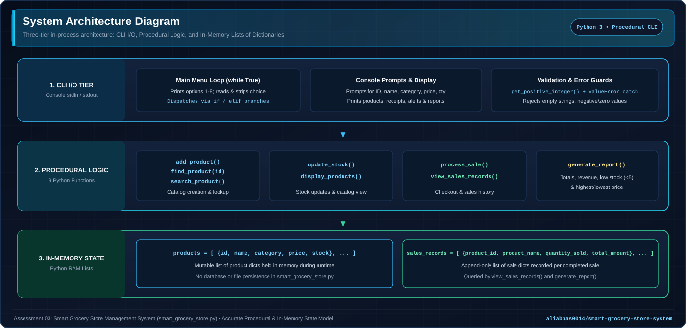
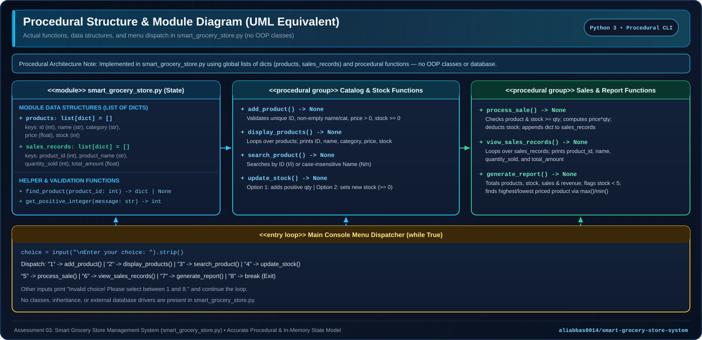
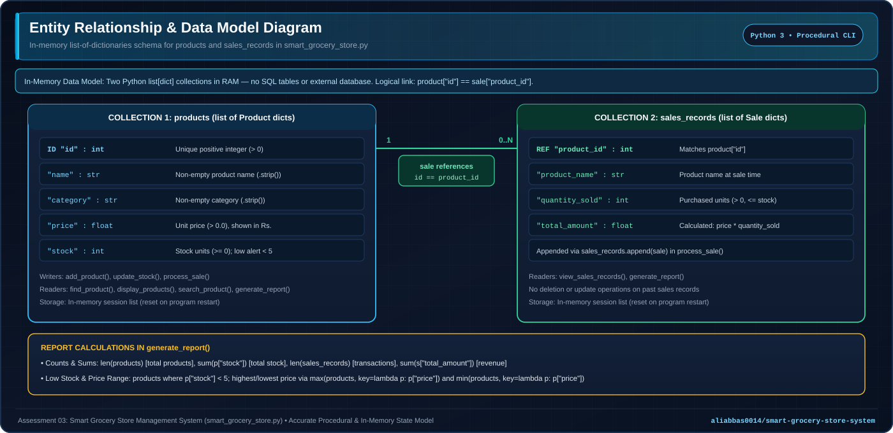
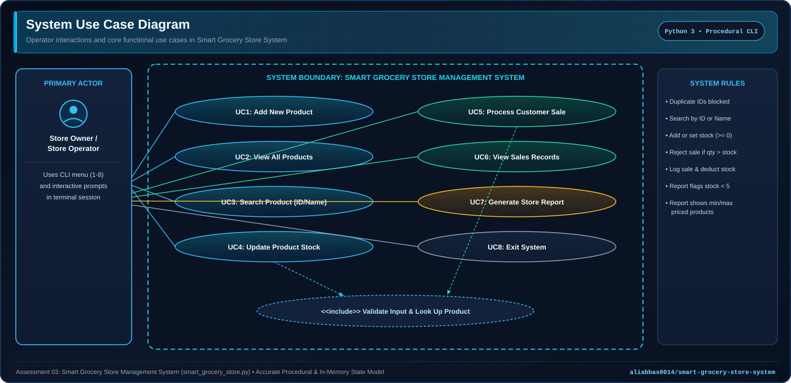
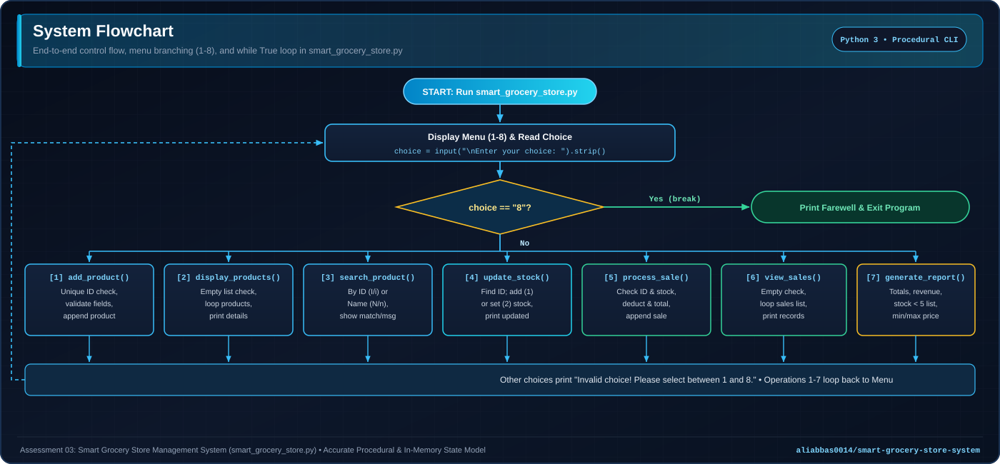
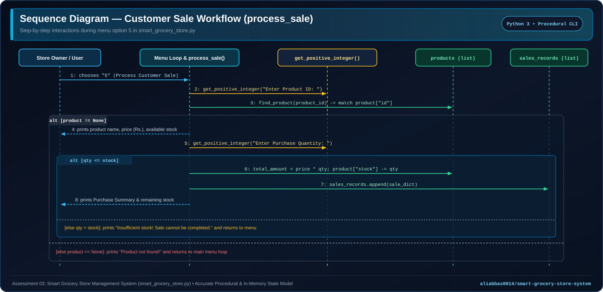
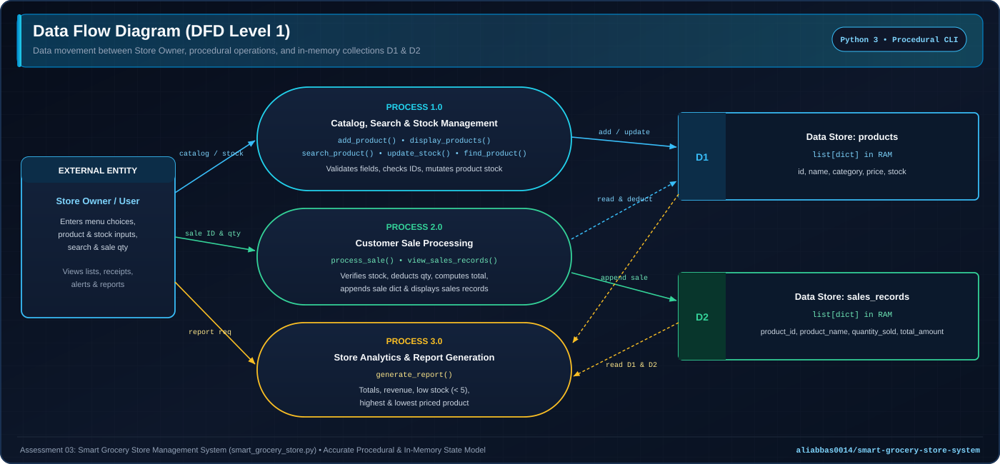
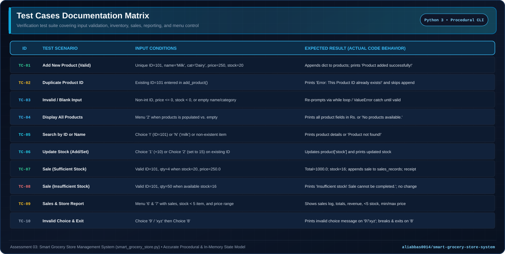
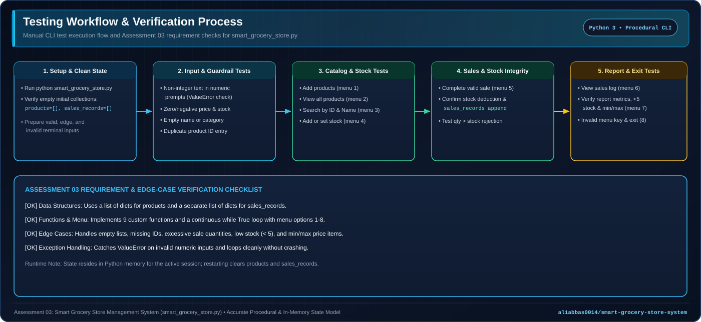

 <div align="center">

# 🛒 Smart Grocery Store Management System


<p>
  
  
  
</p>

### A Python-Based Grocery Store Management Solution

<p>
  <a href="https://aliabbas0014.github.io/smart-grocery-store-system/demo.html">
    
  </a>
  &nbsp;
  <a href="https://github.com/aliabbas0014/smart-grocery-store-system">
    
  </a>
  &nbsp;
  <a href="#-project-overview">
    
  </a>
</p>

</div>

---

## 📌 Project Overview

The **Smart Grocery Store Management System** is a menu-driven console application developed using Python. It helps manage grocery products, monitor inventory, process customer sales, maintain sales records, and generate store reports.

This project demonstrates practical implementation of Python programming concepts, including lists, dictionaries, functions, loops, conditional statements, and input validation.

## ✨ Key Features

| Feature | Description |
|---|---|
| ➕ Add Product | Add products with ID, name, category, price, and stock. |
| 📦 View Products | Display all available products. |
| 🔍 Search Product | Search products by ID or name. |
| 🔄 Update Stock | Add more stock or set a new quantity. |
| 🛒 Process Sale | Calculate bills, check stock, and update inventory. |
| 🧾 Sales Records | Maintain and display sales transactions. |
| 📊 Store Report | Generate inventory and sales summaries. |

## 🧠 Python Concepts Used

- Variables and Data Types
- Lists and Dictionaries
- Dictionary Keys and Values
- Functions and Return Values
- Conditional Statements (`if`, `elif`, `else`)
- `for` and `while` Loops
- List Methods (`append()`)
- Input Validation (`try` and `except`)
- `break` and `return`
- `max()` and `min()` functions

---

## 🏗️ System Design & Architecture

The following diagrams explain the internal structure, data organization, and overall design of the Smart Grocery Store Management System.

### 1. System Architecture



### 2. Function Structure / UML Representation

This diagram represents the actual procedural Python functions and their organization rather than an object-oriented class structure.



### 3. Data Model Diagram

The application uses two in-memory lists of dictionaries to maintain product information and completed sales records.



### 4. Use Case Diagram



---

## 🔄 Application Workflow

These diagrams illustrate how the application processes user requests, manages products, and handles customer sales.

### 5. System Flowchart



### 6. Sequence Diagram



### 7. Data Flow Diagram (DFD)



---

## 🧪 Testing Documentation

Testing documentation demonstrates how the application's main operations and input validation scenarios can be checked.

### 8. Test Cases



### 9. Testing Workflow



---

## 🌐 Interactive Demo

Explore the browser-based demonstration of the project.

<div align="center">

<a href="https://aliabbas0014.github.io/smart-grocery-store-system/demo.html">
  
</a>

</div>

**Demo includes:**

- Sample grocery products
- Product search
- Product selection
- Quantity selection
- Live bill calculation
- Simulated customer sale

> Note: The HTML demo is a separate interactive showcase using sample data. It is not connected to the Python console application.

## 📁 Project Structure

```text
smart-grocery-store-system/
│
├── assets/
│   ├── smart-grocery-store/
│   │   ├── uml-class-diagram.svg
│   │   ├── entity-relationship-diagram.svg
│   │   ├── use-case-diagram.svg
│   │   ├── system-architecture.svg
│   │   ├── sequence-diagram.svg
│   │   ├── system-flowchart.svg
│   │   ├── data-flow-diagram.svg
│   │   ├── test-cases.svg
│   │   └── testing-workflow.svg
│   │
│   └── svg-buttons/
│       ├── live-demo.svg
│       ├── source-code.svg
│       └── explore-project.svg
│
├── smart_grocery_store.py
├── demo.html
└── README.md
```

## ⚙️ Requirements

- Python 3.x
- Visual Studio Code or any code editor
- Terminal or Command Prompt

No external Python packages are required.

## ▶️ How to Run

1. Clone or download this repository.
2. Open the project folder in Visual Studio Code or Command Prompt.
3. Run the following command:

```bash
py smart_grocery_store.py
```

Alternatively:

```bash
python smart_grocery_store.py
```

4. Select an option from the menu and follow the instructions.

## 🧾 Example Sale

```text
Product: Milk
Price: Rs. 250
Available Stock: 20
Purchase Quantity: 3

Total Amount: Rs. 750
Remaining Stock: 17

Sale completed successfully!
```

## 📊 Store Report

The application generates a report containing:

- Total number of products
- Total available stock
- Number of sales transactions
- Total sales revenue
- Products with stock below 5 units
- Highest-priced product
- Lowest-priced product

## 🛡️ Input Validation

The system includes validation to prevent common input errors:

- Duplicate product IDs are not allowed.
- Product names and categories cannot be empty.
- Product prices must be greater than zero.
- Stock quantities cannot be negative.
- Sales cannot exceed available stock.
- Invalid menu choices are handled appropriately.

## ⚠️ Current Limitations

- Product and sales data are stored in memory and reset when the program closes.
- The HTML demo uses separate sample data.
- No database or user authentication is currently implemented.

## 🚀 Future Improvements

- Database integration for permanent data storage.
- User authentication for store staff.
- Downloadable customer invoices.
- Date-wise sales reports.
- Integration with a web-based interface.

---

## 👨‍💻 About the Developer

<div align="center">

### Ali Abbas

**Software Engineering Graduate | Python & Web Development**

<p>
  <a href="https://github.com/aliabbas0014">
    
  </a>
  <a href="https://www.linkedin.com/in/the-aliabbas/">
    
  </a>
</p>

---

### 💡 Learn • Build • Improve

*Developed as a practical Python programming project.*

</div>
